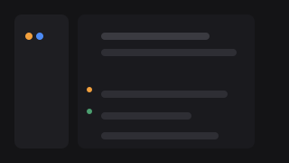

# dsh-tag

给 DeepSeek Harness 的聊天窗口打标签：选中一段话打个标，之后随时从侧边的标签轨道跳回去。

标签可以自己起名字、自己配色，跳转后目标文字会按标签颜色闪几下。

## 功能

- **划词打标**：在聊天里选中任意文字，选区下方浮出「打标签」按钮，填写标题 / 备注，或直接点一个已有标签。
- **左侧标签轨道**：对话区左侧有一条竖直轨道，每个标签按它在整段会话里的位置比例摆一个色块。点色块直接跳到对应内容，悬停显示备注与标题，右键可编辑或删除。
- **跳转定位**：先加载到目标事件（`loadThrough`），再依次尝试「轮次锚点 → 限定范围内的文本匹配 → 浏览器查找」三级定位；命中后滚动到目标并把高亮框覆盖在原文上，闪烁 5 次后退场；只能定位到轮次级时改为常亮，避免让人误以为精确命中。
- **总览面板**：侧栏面板里的「标签」页，列出所有标记，可按标签筛选，可改标签名称 / 颜色 / 删除，点击条目跳转。
- **会话行色点**：侧栏会话列表每行的尾部显示该会话用到的标签颜色（最多 3 个）。
- **给 Agent 用**：注册了 `chat_tags_list` / `chat_tags_mark` / `chat_tags_delete` 三个工具，模型可以自己打标签、查标签。

## 界面



左侧竖直色条是标签轨道，每个色块对应一条标记，位置按它在整段会话中的比例摆放；点一下跳到那条内容。

## 安装

需要 DSH 桌面版（或 `dsh` 服务端），且 profile 允许加载第三方 bundle 插件。

```bash
git clone https://github.com/Zi-Kong/dsh-tag.git
```

然后在 DSH 的插件管理里安装这个本地 bundle，`target` 指向克隆下来的目录：

```
file:<克隆目录的绝对路径>
```

安装后刷新页面（`Ctrl+R`）即可看到侧栏多出「标签」图标，不用重启 DSH。

> Host 侧代码（`index.js`）的改动需要重启 DSH 才会生效，Client 侧（`client.js`、CSS）刷新页面即可。

## 使用

1. 在聊天里选中一段文字 → 点选区下方的「打标签」。
2. 新建一个标签（名字 + 颜色），或挑一个已存在的。
3. 之后点左侧轨道上的色块就能跳回去；也可以从侧栏「标签」面板里跳。
4. 想改标签名字或颜色：点面板里标签 chip 上的 `⋯`，或右键轨道色块。

## 数据

标记与标签存在本地：

```
$DSH_HOME/storages/dsh-chat-tags/data.json
```

默认 `$DSH_HOME` 是 `~/.dsh`。结构：

```json
{
  "tags":  [{ "id": "t_xxx", "name": "待办", "color": "#4c8bf5" }],
  "marks": [{ "id": "m_xxx", "tagId": "t_xxx", "sessionId": "session-...",
              "seq": 1257, "text": "选中的原文", "title": "标题",
              "note": "备注", "createdAt": 1764030000000 }]
}
```

## HTTP 接口

Host 半挂载在 `/chat-tags` 前缀下：

| 方法 | 路径 | 说明 |
| --- | --- | --- |
| GET | `/chat-tags/state` | 全部标签与标记 |
| POST | `/chat-tags/tag/create` | 新建标签 `{ name, color }` |
| POST | `/chat-tags/tag/update` | 改名 / 改色 `{ id, name?, color? }` |
| POST | `/chat-tags/tag/delete` | 删除标签及其标记 `{ id }` |
| POST | `/chat-tags/mark/create` | 新建标记 |
| POST | `/chat-tags/mark/update` | 修改标记 `{ id, title?, note?, tagId? }` |
| POST | `/chat-tags/mark/delete` | 删除标记 `{ id }` |

写入是「先写 `.tmp` 再 rename」的原子写。

## Agent 工具

| 工具 | 说明 |
| --- | --- |
| `chat_tags_list` | 列出标记，可按 `sessionId` 过滤 |
| `chat_tags_mark` | 给某段文字打标（`sessionId` + `text` 必填，`tagId` 或 `tagName` 二选一） |
| `chat_tags_delete` | 删除一条标记 |

## 实现要点

- 无构建步骤：`client.js` 直接用 `window.__ModuleLoader__.load` 注册，纯 ES5 风格 JS + `React.createElement`。
- 划词气泡是**自绘**的：DSH 的 `conversation.chat.text-interaction` 是独占式分发（第一个 `open()` 的消费者赢），第三方插件抢不到，所以改为在 `shell.overlay` 里监听 `selectionchange` 自己定位。
- 左侧轨道挂在 `shell.overlay`，只用自己注入的锚点元素算位置，不读其他插件的 DOM。
- 高亮框用 `Range.getClientRects()` 逐行画，避免跨行 / 标题被外接矩形一整块框住。
- 浮层（右键菜单、高亮框）都挂到 `document.body`，避免被带 `transform` 的容器当成包含块导致定位偏移。
- 颜色全部取自 DSH 主题 token（`--dsw-alias-bg-layer-*`、`--dsw-alias-border-*`、`--dsw-alias-label-*`），跟随明暗主题。

## 开发

```bash
node --check client.js
node --check index.js
```

改完 `client.js` 在 DSH 里 `Ctrl+R` 刷新；改 `index.js` 需要重启 DSH。

## License

MIT